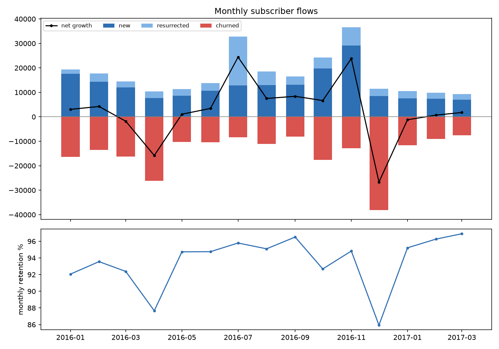
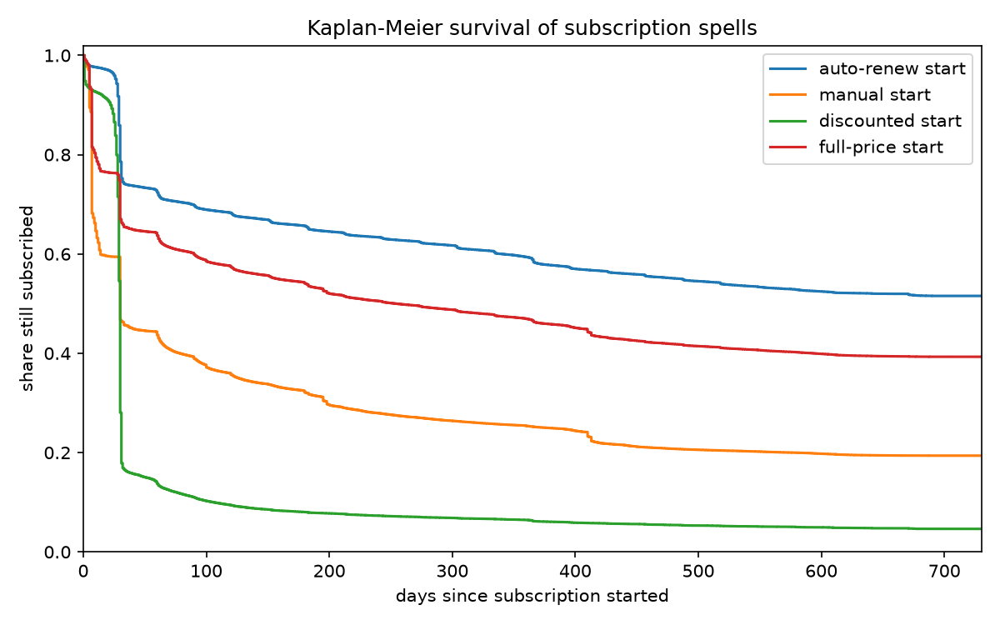
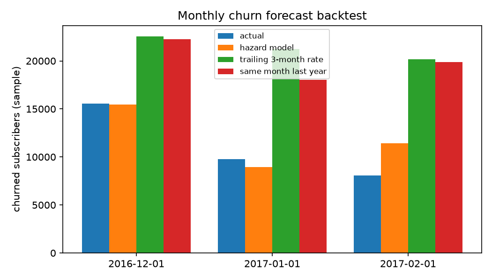
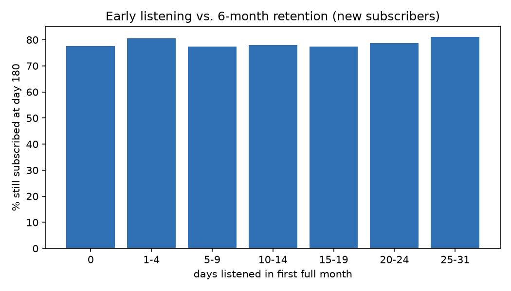
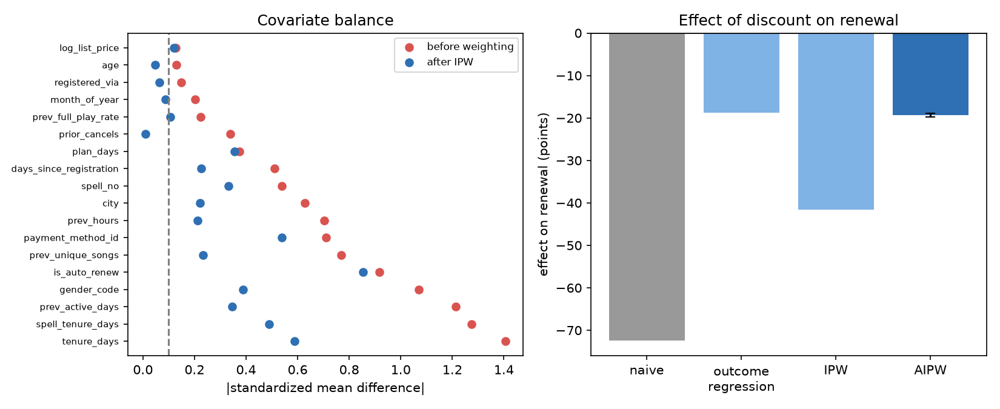

# Subscriber Growth Lab: results

## Data

- Users: 482,490 (20% sample) · paid transactions: 4,420,541 · cancellations: 177,844
- Subscription spells: 606,904 · subscriber-months: 5,322,612 · listening user-months: 5,585,516
- Discounted payments: 3.0% · auto-renew payments: 84.2%

## 1. Growth accounting (Duolingo-style user states)

Months 2016-01-01 to 2017-03-01: active subscribers went from 209,263 to 245,716. Average monthly retention 93.6%, monthly resurrection of lapsed subscribers 2.90%. 26.3% of gross adds were returning subscribers.

**Which lever matters most?** Subscribers after 12 months vs. the base projection:

| lever | lift |
|---|---|
| retention +1 pt | +7.7% |
| resurrection +1 pt | +8.2% |
| new subscribers +10% | +4.2% |

**Paying but not listening = at risk.** Churn next month by listening this month:

| listening | subscriber_months | churn_next_month |
|---|---|---|
| listened 1-9 days | 678,491 | 10.9% |
| listened 10+ days | 1,862,031 | 2.5% |
| paid, did not listen | 635,062 | 12.6% |

## 2. Survival and churn forecasting

| group | spells | median_days | survival_90d | survival_180d | survival_365d | share_censored |
|---|---|---|---|---|---|---|
| auto-renew start | 230,315 | not reached | 69.7% | 65.7% | 58.8% | 59.6% |
| manual start | 234,911 | 30 | 38.9% | 32.1% | 25.2% | 25.4% |
| 30-day plan | 303,763 | 325 | 63.3% | 56.1% | 48.3% | 50.9% |
| other plan length | 161,463 | 10 | 36.9% | 34.4% | 29.3% | 26.1% |
| discounted start | 53,970 | 30 | 11.0% | 8.0% | 6.2% | 6.5% |
| full-price start | 411,256 | 254 | 59.9% | 54.1% | 46.6% | 47.0% |

**Discrete-time hazard model**, trained 2015-07-01 to 2016-11-01, tested on 2016-12-01, 2017-01-01, 2017-02-01. Row-level AUC 0.856, log loss 0.1318.

| month | subscribers | actual_churn | hazard_model | trailing_3m_rate | same_month_last_year |
|---|---|---|---|---|---|
| 2016-12-01 | 244,471 | 15,578 | 15,438 | 22,565 | 22,265 |
| 2017-01-01 | 243,259 | 9,761 | 8,929 | 21,263 | 18,049 |
| 2017-02-01 | 243,951 | 8,066 | 11,439 | 20,161 | 19,878 |

Mean absolute % error of the monthly churn count: hazard_model 17.1%, trailing_3m_rate 104.2%, same_month_last_year 91.4%

Top features (drop in AUC when shuffled): days_left (0.219), payment_method_id (0.032), list_price (0.017), is_auto_renew (0.013), tenure_months (0.010), cancel_known (0.010), prev_active_days (0.003), plan_days (0.002)

## 3. Early listening as a leading indicator

147,534 new subscribers; 78.9% still subscribed at day 180.

| active_days | subscribers | retained_180d |
|---|---|---|
| 0 | 30,355 | 77.6% |
| 1-4 | 13,488 | 80.6% |
| 5-9 | 14,639 | 77.3% |
| 10-14 | 15,521 | 78.0% |
| 15-19 | 16,869 | 77.3% |
| 20-24 | 19,395 | 78.7% |
| 25-31 | 37,267 | 81.1% |

Best split: **25+ listening days** in the first full month (25.3% of new subscribers). They kept 81.1% at day 180 vs. 78.1% for the rest (1.0x). Correlation, not causation.

## 4. Causal effect of discount on retention

| outcome | n | treated | naive | outcome reg. | IPW | AIPW | AIPW 95% CI |
|---|---|---|---|---|---|---|---|
| renewed | 363,235 | 47,571 | -72.4 pts | -18.8 pts | -41.7 pts | -19.4 pts | [-19.8 pts, -19.0 pts] |
| active_180d | 262,318 | 46,354 | -64.1 pts | -15.4 pts | -37.3 pts | -15.9 pts | [-16.4 pts, -15.5 pts] |
| placebo_active_days_2m_before | 363,235 | 47,571 | -9.42 days | +0.08 days | -3.39 days | +0.06 days | [+0.02 days, +0.09 days] |

- Balance: largest standardized mean difference 1.40 before weighting, 0.85 after (under 0.1 is the usual bar).
- Overlap: 92.7% of units have propensity outside 0.05-0.95; AIPW on the trimmed sample is -32.1 pts.
- Listening last month: treated 0.8 days vs. control 11.1 days.
- Placebo: the treatment cannot change listening that happened before it. An adjusted estimate near zero means the adjustment is working; a large one means hidden confounding.

## Draft resume bullets (check every number against the tables above)

- Built a Duolingo-style growth model for 482,490 subscribers of a music streaming service, splitting monthly growth into new, retained, resurrected and churned users. It showed resurrection +1 pt grows the base most (+8.2% in 12 months).
- Built a discrete-time hazard model on subscriber-months that forecast monthly churn with 17.1% error vs. 91.4% for the best simple baseline.
- Estimated the effect of discounts on renewal with cross-fitted AIPW: naive comparison -72.4 pts, adjusted -19.4 pts, with balance and placebo checks.
